# Hyperkuy catalog

_Generated by `node tools/hyperkuy.mjs gallery` from `catalog.json` — do not edit by hand._

**90 designs** · Claude Opus 59 · Claude Fable 21 · ChatGPT Astra 10 · 69 templates · 11 video references · 10 concepts

Use any design by name: `node tools/hyperkuy.mjs render "Dusk Mode" --data my-topic.json` (see README).

## Claude Opus

| Cover | Name · id | Type · rating | Look (background · type · depth · visual) | Series | Idea |
|---|---|---|---|---|---|
| 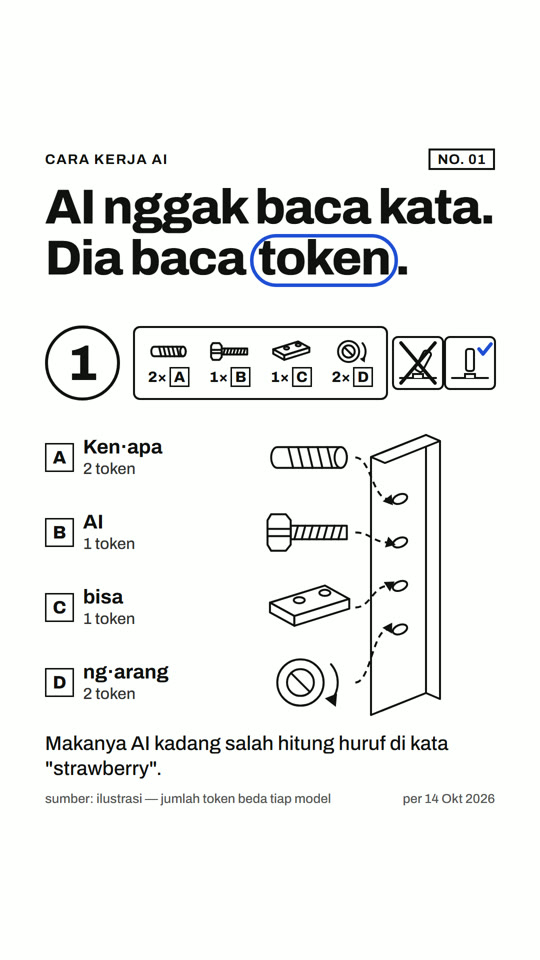 | **Assembly Manual** `assembly-manual` | template · New | light · grotesque · 2D · physical-object | how-ai-works, ai-tools | A flat-pack assembly manual in black line art. Metaphor: how AI works, assembled part by part. |
| 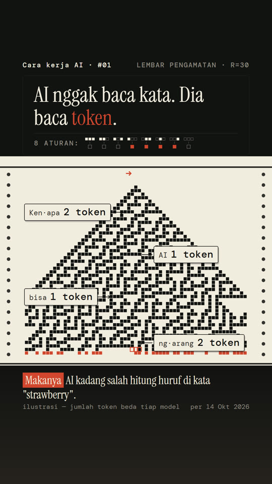 | **Automaton Rows** `automaton-rows` | template · New | dark-to-light · mono · 2D · code | how-ai-works | Rule 30 printed row by row on tractor-feed paper beside its 8-rule card. Metaphor: emergence, a tiny next-token rule repeated gives rich, surprising output. |
| 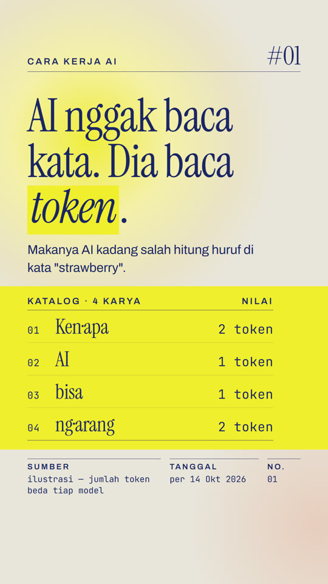 | **Biennale Yellow** `biennale-yellow` | template · Liked | light · serif · 2D · poster | ai-news | Exhibition catalogue on warm paper with a yellow haze and thin navy serif. |
| 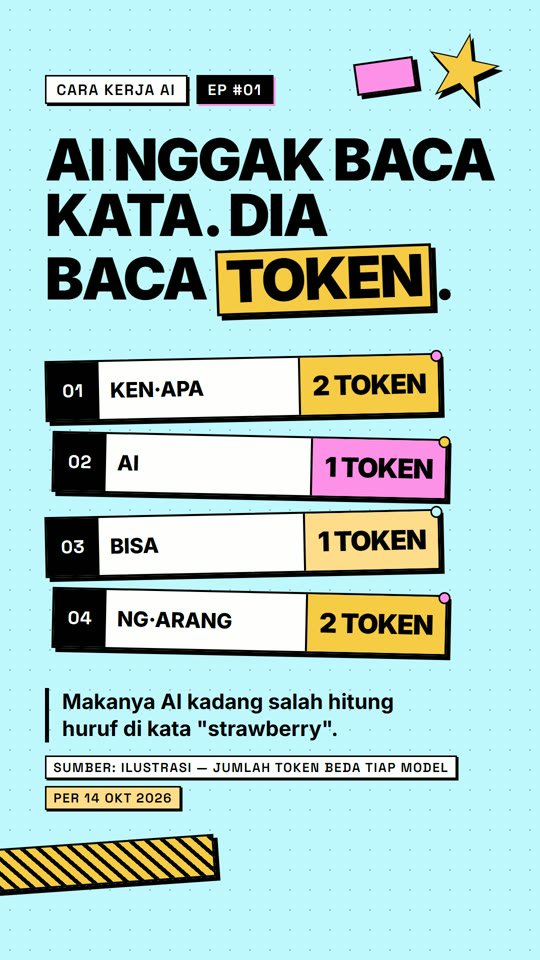 | **Blockframe** `blockframe` | template · Liked | light · grotesque · 2D · physical-object | ai-news, ai-tools | Sharp neo-brutalist cards: thick black borders, hard offset shadows, slight tilts. |
| 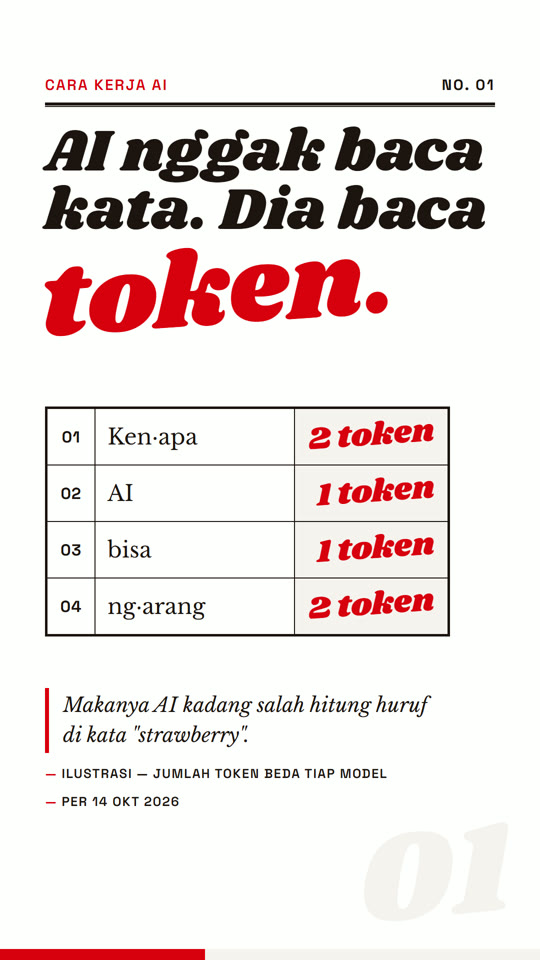 | **Bold Poster** `bold-poster` | template · Liked | light · serif · 2D · poster | ai-in-numbers, ai-news | Vintage sports-magazine poster: classical serif, tomato red, a ruled stats table. |
| 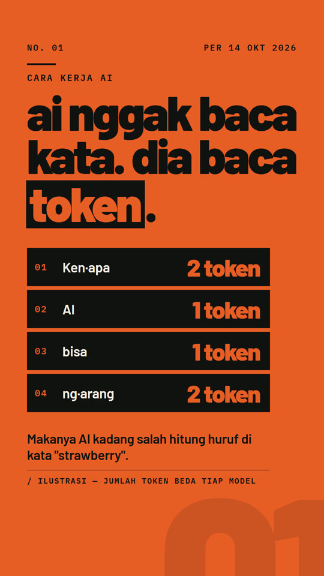 | **Broadside** `broadside` | template · Liked | full-colour · condensed · 2D · poster | ai-in-numbers, ai-news | Fire-orange broadside with massive flat type and black slabs. |
| 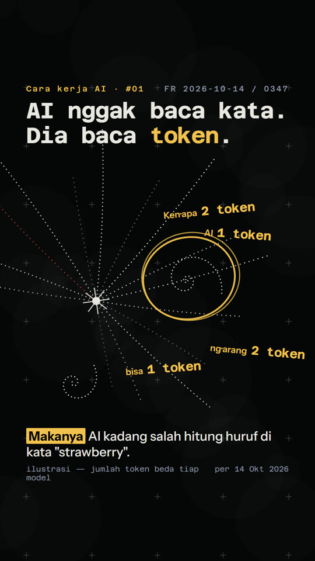 | **Bubble Chamber** `bubble-chamber` | template · New | dark · mono · 2D · diagram | how-ai-works, ai-news | A bubble-chamber photograph of particle tracks. Metaphor: interpretability, researchers never see the model's features directly, only the traces they leave when they fire. |
| 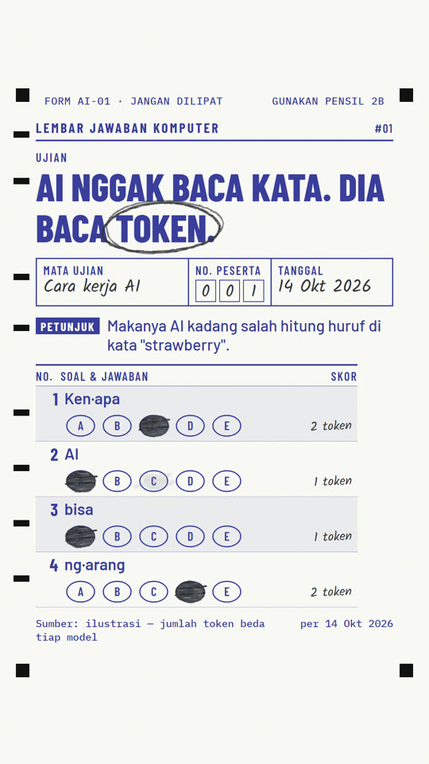 | **Bubble Test** `bubble-test` | template · New | light · condensed · 2D · physical-object | how-ai-works, ai-in-numbers | A machine-graded multiple-choice answer sheet with 2B pencil bubbles. Metaphor: the AI chooses an answer by likelihood. |
| 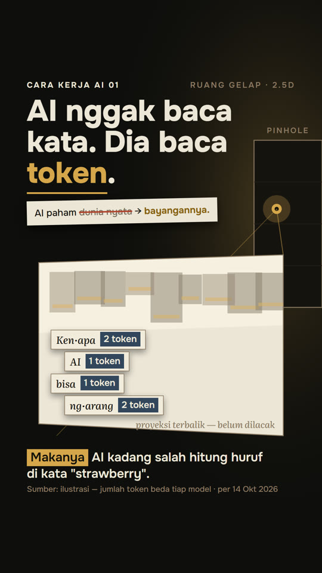 | **Camera Obscura** `camera-obscura` | template · New | dark-to-light · grotesque · 2.5D · poster | how-ai-works | A blacked-out room turned camera obscura, a skyline projected upside down on a table. Metaphor: a language model only sees a dim projection of the world, text written about it. |
| 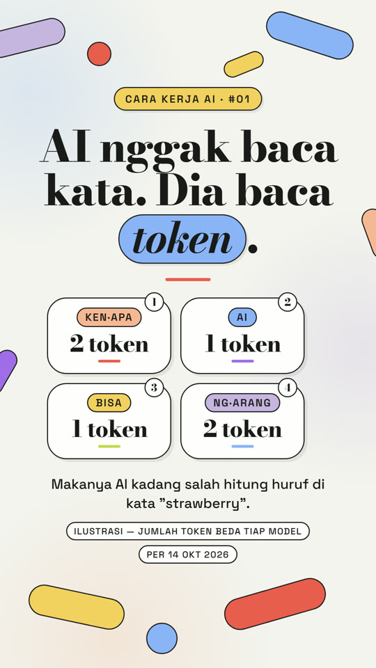 | **Capsule** `capsule` | template · Liked | light · serif · 2D · poster | ai-news | High-contrast Bodoni with candy-coloured capsule pills. |
| 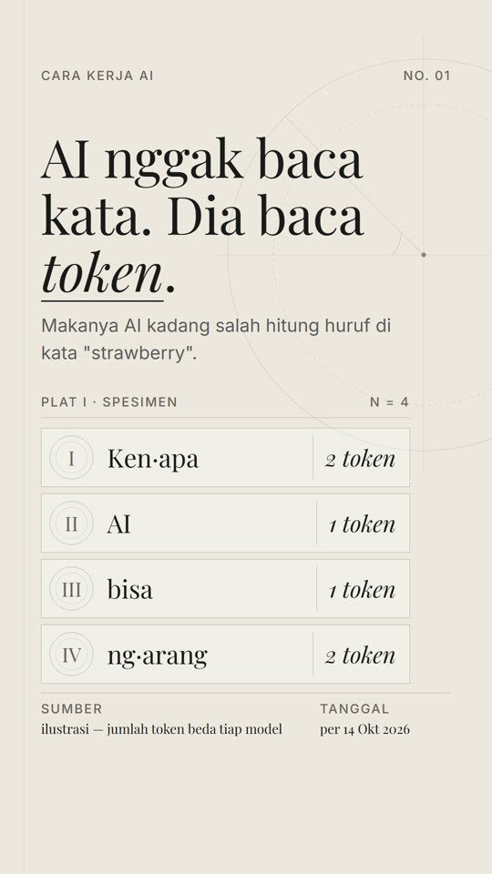 | **Cartesian** `cartesian` | template · Liked | light · serif · 2D · diagram | how-ai-works | Quiet museum catalogue: specimen cards, hairlines, compass geometry. |
| 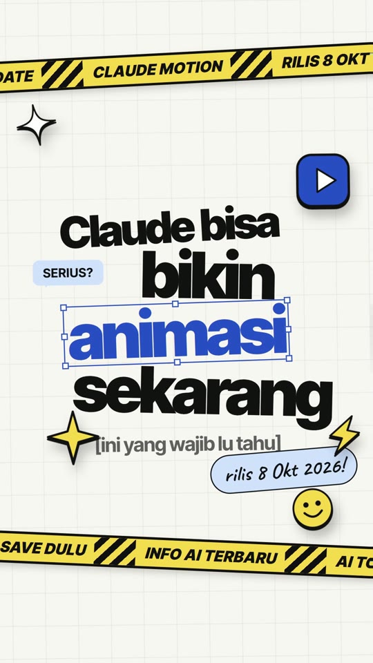 | **Caution Tape Pop** `caution-tape-pop` | reference · Liked | pastel · grotesque · 2D · poster | ai-in-numbers, ai-news | Loud news-style poster: caution tape running top and bottom, giant tight headline, stickers. |
| 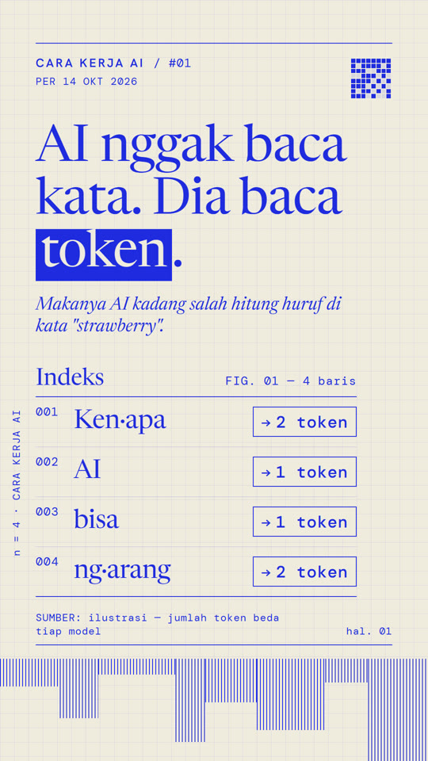 | **Cobalt Grid** `cobalt-grid` | template · Liked | light · serif · 2D · diagram | how-ai-works | Graph paper with electric cobalt riso printing and an indexed table. |
| 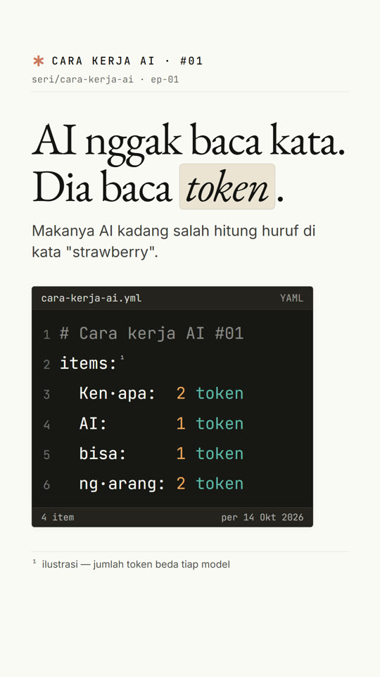 | **Code Editorial** `code-editorial` | template · Liked | light · serif · 2D · code | ai-tools | Editorial page in Garamond with a navy YAML code window and footnoted sources. |
| 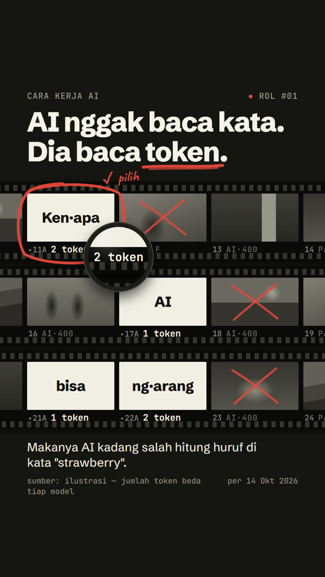 | **Contact Sheet** `contact-sheet` | template · New | dark · grotesque · 2D · physical-object | how-ai-works, ai-tools | A photographer's contact sheet: film strips, edge printing, red grease-pencil picks. Metaphor: the AI picks one candidate out of many. |
| 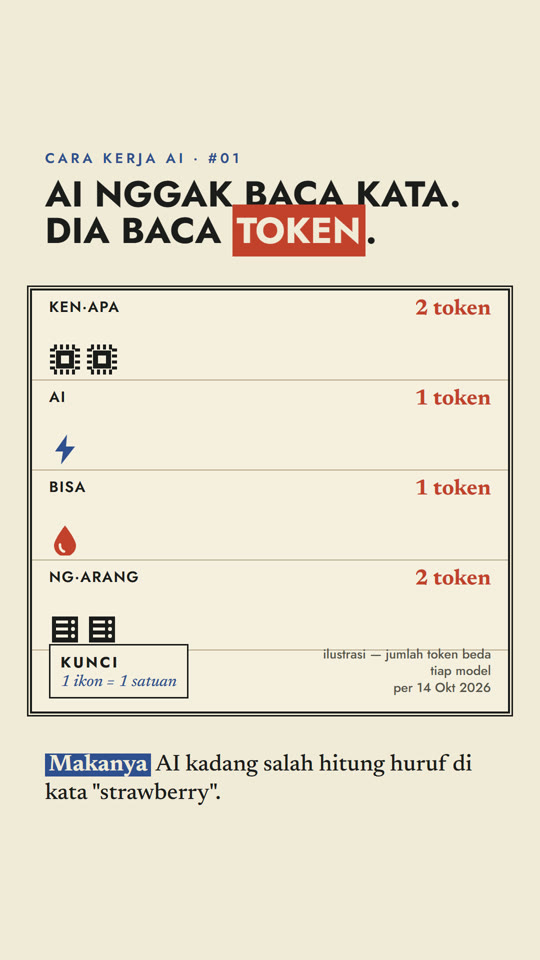 | **Counted Figures** `counted-figures` | template · New | light · grotesque · 2D · data | ai-in-numbers, ai-news | A 1930s Isotype pictorial-statistics board. Metaphor: AI scale you literally count, a bigger number means more identical figures, never a bigger icon. |
| 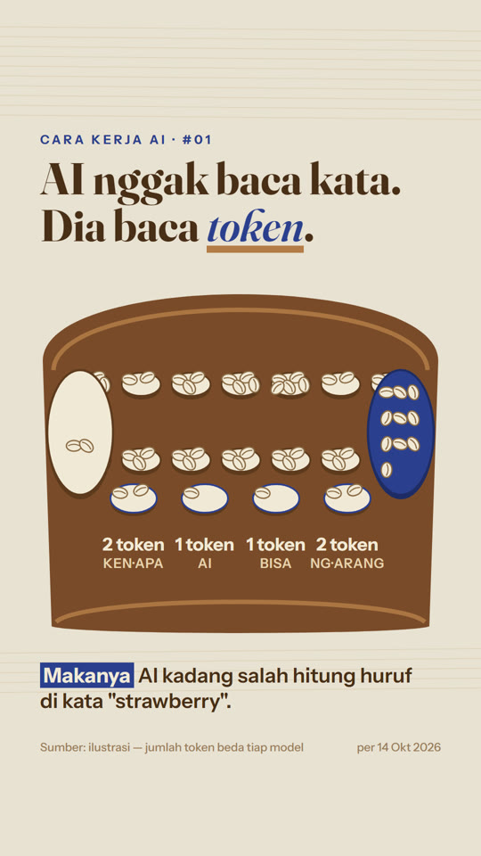 | **Cowrie Board** `cowrie-board` | template · New | light · serif · 3D · physical-object | how-ai-works, ai-in-numbers | A carved congklak board in low 3/4 view on linen. Metaphor: self-play reinforcement learning, the AI plays both sides, keeps what wins and improves without copying human games. |
| 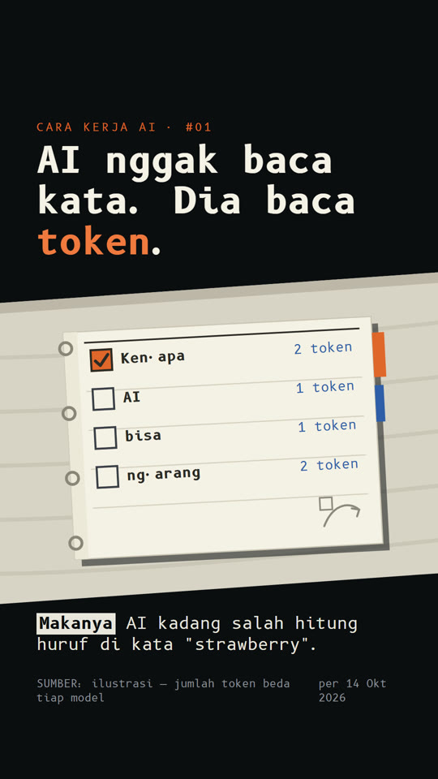 | **Cuff Checklist** `cuff-checklist` | template · New | dark · mono · 3D · physical-object | ai-tools, how-ai-works | A ring-bound mission checklist on a pressure-suit cuff, shot against black. Metaphor: an AI agent's plan, terse steps, one tool call per line, ticked off one by one. |
| 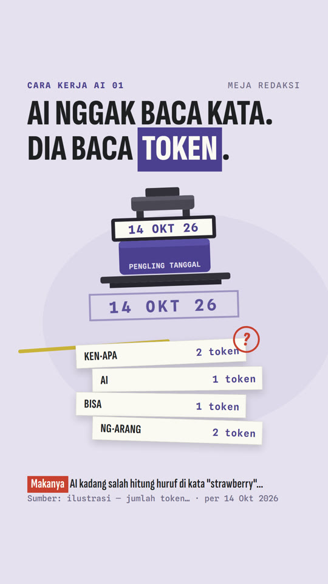 | **Cutoff Dater** `cutoff-dater` | template · New | pastel · condensed · 2.5D · physical-object | ai-news, how-ai-works | A self-inking date stamp over a fan of pages on a lavender desk. Metaphor: knowledge cutoff, everything the model knows carries one date, and later questions still get the old stamp. |
| 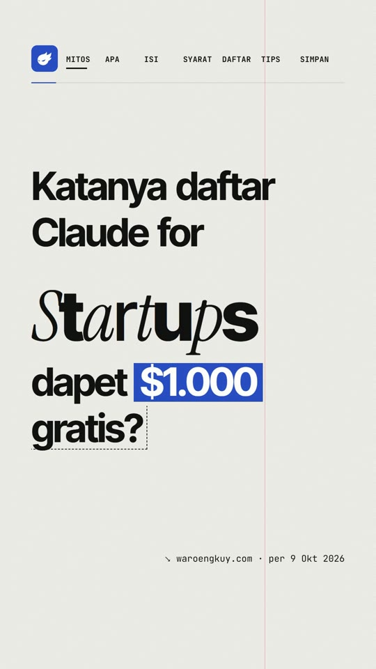 | **Design Canvas** `design-canvas` | reference · Liked | light · grotesque · 2D · app-ui | how-ai-works | The whole explainer lives inside a design tool: selections, cursors, dotted connectors. |
| 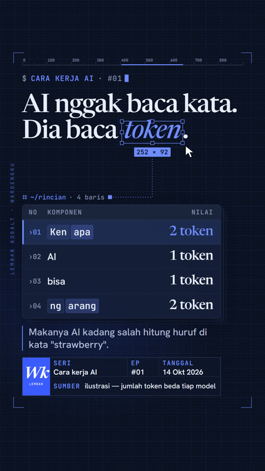 | **Drafting Dark** `drafting-dark` | template · New | dark · serif · 2.5D · app-ui | ai-in-numbers | The dark twin of Drafting Light: deep blue-charcoal sheet, glassy spec card, terminal accents. |
| 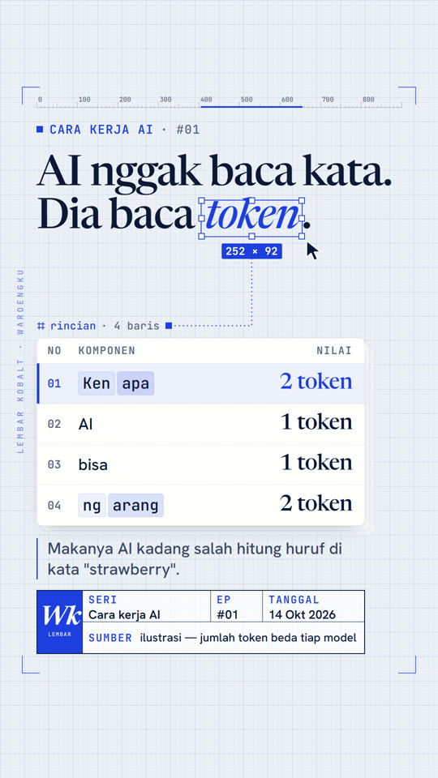 | **Drafting Light** `drafting-light` | template · New | light · serif · 2.5D · app-ui | how-ai-works | Engineering drawing sheet on millimetre grid: title block, crop marks, spec card, design-tool selection with dotted connectors. |
| 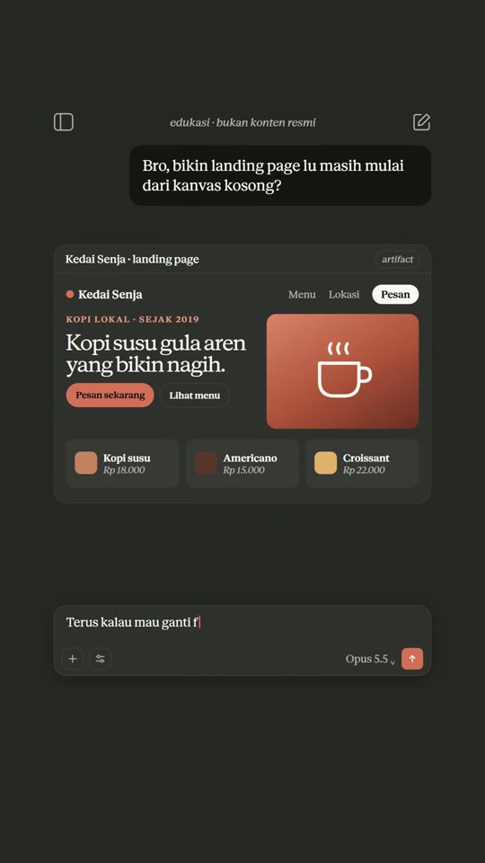 | **Dusk Mode** `dusk-mode` | reference · Liked | dark-to-light · serif · 2.5D · app-ui | ai-tools | A dark AI chat app that brightens as a one-prompt result is built and edited on screen. |
| 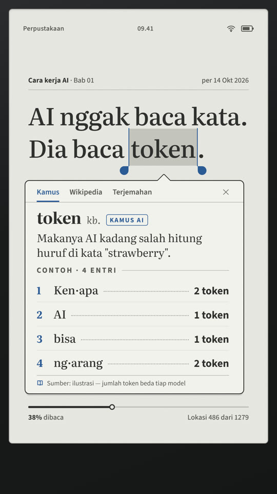 | **E-Reader Lookup** `e-reader` | template · New | light · serif · 2D · app-ui | how-ai-works | An e-ink reader page: long-press a word, a dictionary popover explains it. Metaphor: tap an AI term, get its meaning. |
| 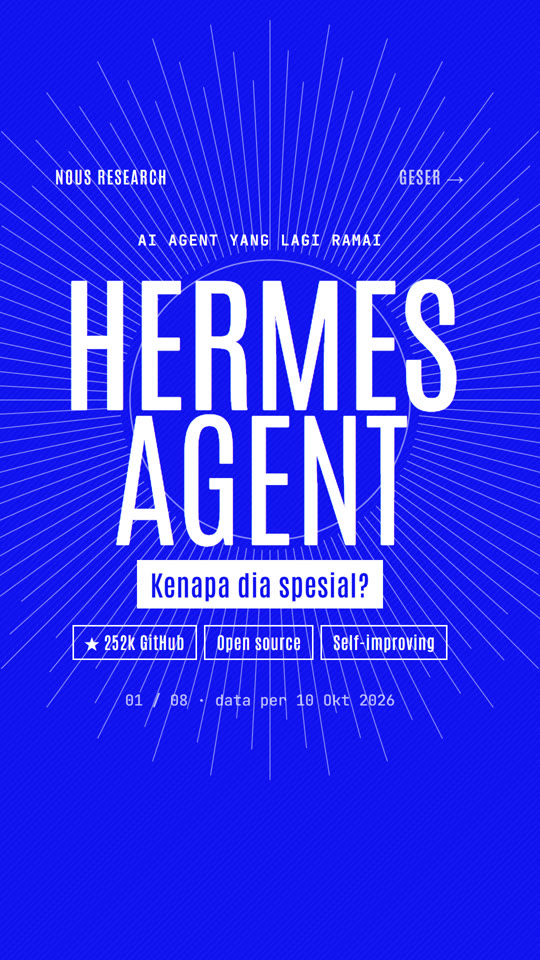 | **Electric Sunburst** `electric-sunburst` | reference · Liked | full-colour · condensed · 2D · poster | ai-news | Electric-blue poster with tall condensed type and engraved sunburst lines. |
| 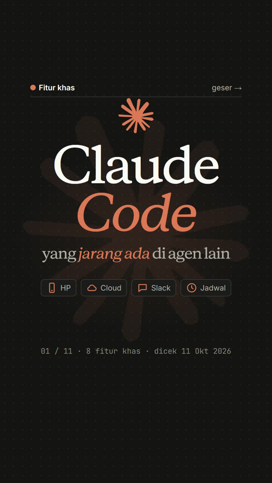 | **Ember Docs** `ember-docs` | reference · Liked | dark · serif · 2D · app-ui | ai-tools | Warm charcoal docs page: cream serif headline with an ember-orange italic, terminal boxes. |
| 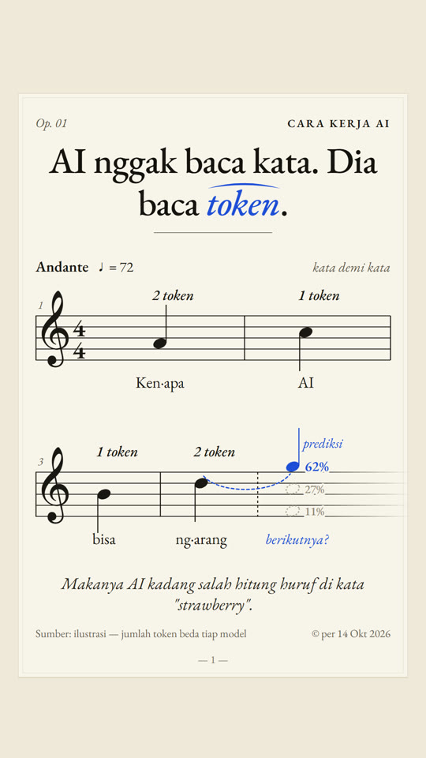 | **Engraved Score** `engraved-score` | template · New | light · serif · 2D · diagram | how-ai-works | Engraved sheet music with staves and lyrics. Metaphor: predicting the next note = predicting the next token. |
| 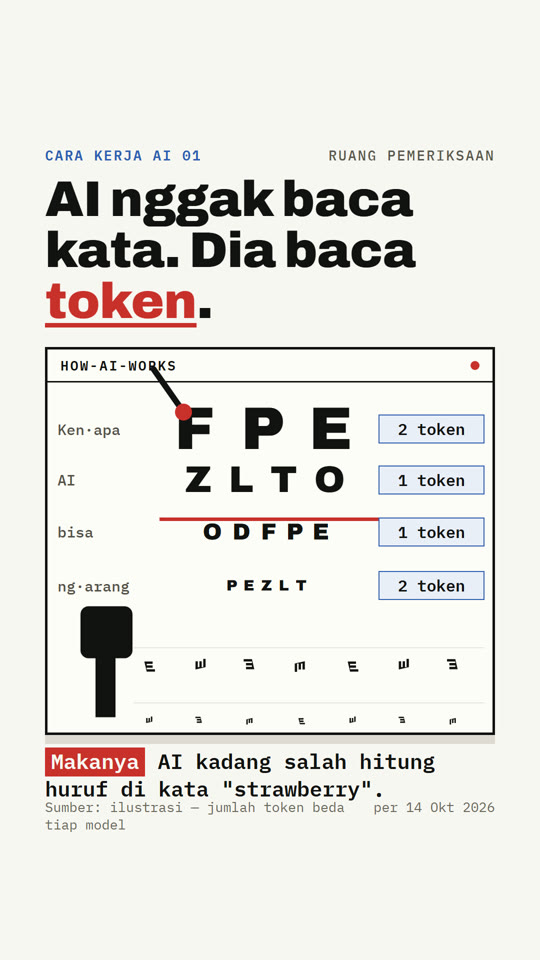 | **Eye Chart** `eye-chart` | template · New | light · grotesque · 2D · poster | ai-in-numbers, ai-news | A backlit Snellen eye chart. Metaphor: benchmarks, each row is a harder test and a model's score is the smallest row it can still read. |
| 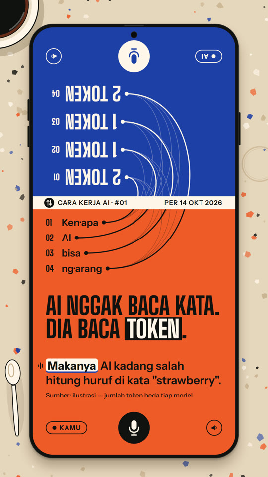 | **Face to Face** `face-to-face` | template · New | full-colour · condensed · 2D · app-ui | how-ai-works, ai-tools | A phone on a terrazzo cafe table in two-way translator mode, screen split head-to-tail for the person opposite. Metaphor: encoder reads your side, decoder writes theirs, attending back across the fold. |
| 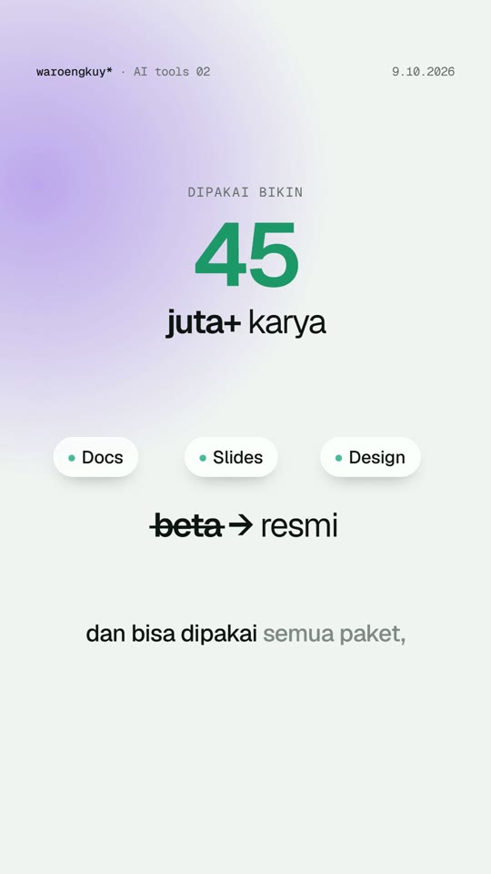 | **Frosted Orbs** `frosted-orbs` | reference · Liked | light · grotesque · 2.5D · abstract | how-ai-works | Calm launch-film look: soft blurred colour orbs behind frosted glass cards. |
| 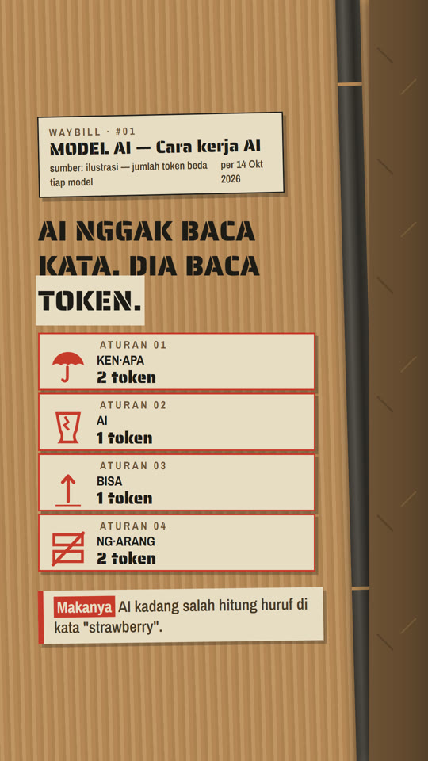 | **Handling Marks** `handling-marks` | template · New | full-colour · condensed · 3D · physical-object | ai-tools, ai-news | A full-bleed kraft shipping crate with ISO handling pictograms and a waybill. Metaphor: guardrails, a model ships with handling rules every app that holds it must respect. |
| 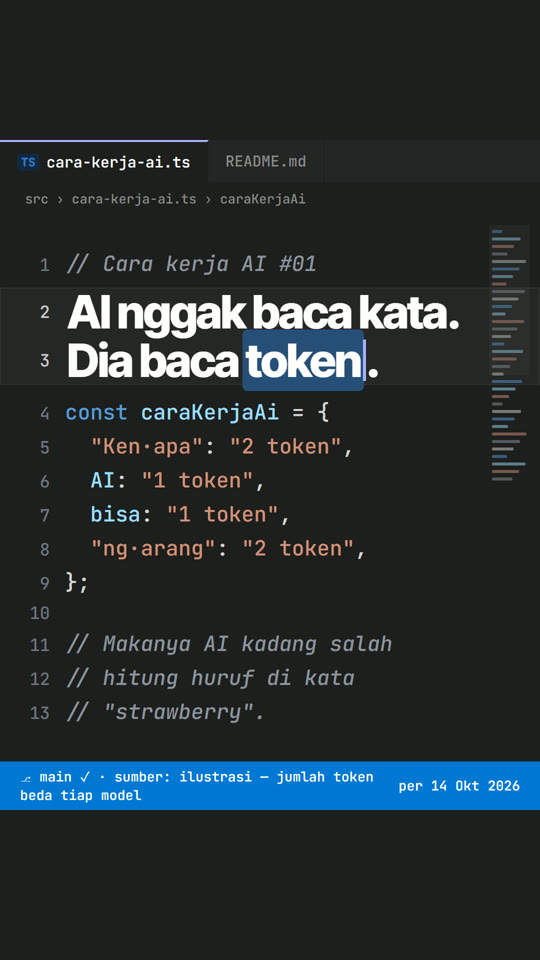 | **IDE Nocturne** `ide-nocturne` | template · Liked | dark · mono · 2D · code | how-ai-works | A night-mode code editor: tabs, line numbers, minimap; items become an object literal. |
| 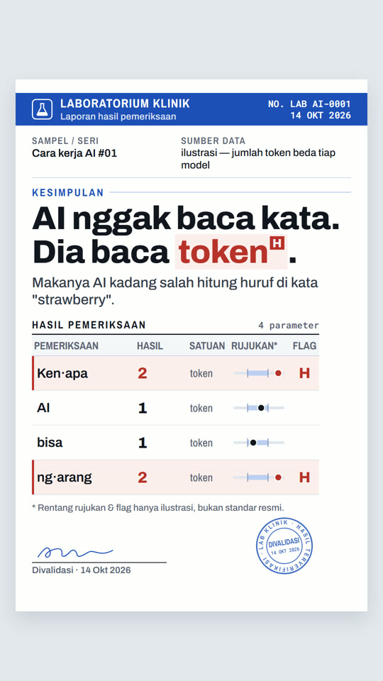 | **Lab Report** `lab-report` | template · New | light · grotesque · 2D · data | ai-in-numbers | A clinical lab report with reference ranges and H/L flags. Metaphor: read AI numbers against a normal range. Ranges are illustrative. |
| 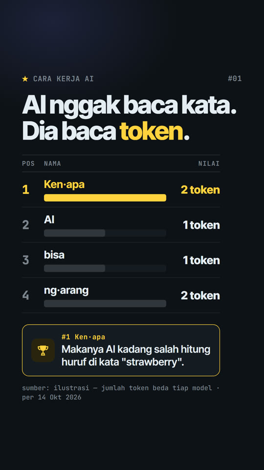 | **Leaderboard** `leaderboard` | template · Liked | dark · grotesque · 2D · data | ai-in-numbers | A league standings table: position, name, value and a bar per row, plus a winner card. |
| 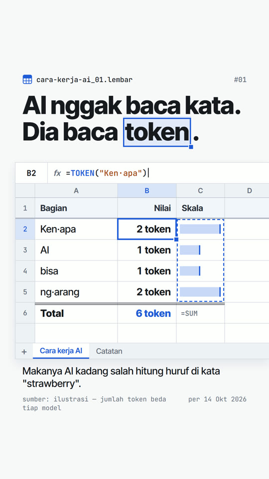 | **Live Spreadsheet** `live-spreadsheet` | template · New | light · mono · 2D · app-ui | ai-in-numbers, ai-tools | A spreadsheet with a formula bar, active cell and in-cell data bars. Metaphor: AI numbers and costs computed cell by cell. |
| 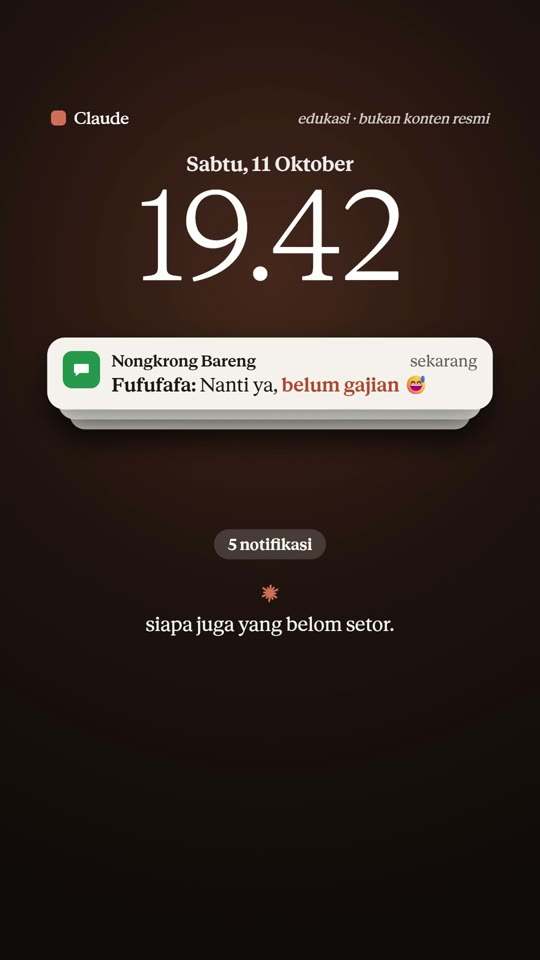 | **Lockscreen Story** `lockscreen-story` | reference · Liked | dark-and-light · serif · 2.5D · app-ui | ai-tools | Starts on a phone lock screen full of relatable notifications, then turns into a step-by-step result. |
| 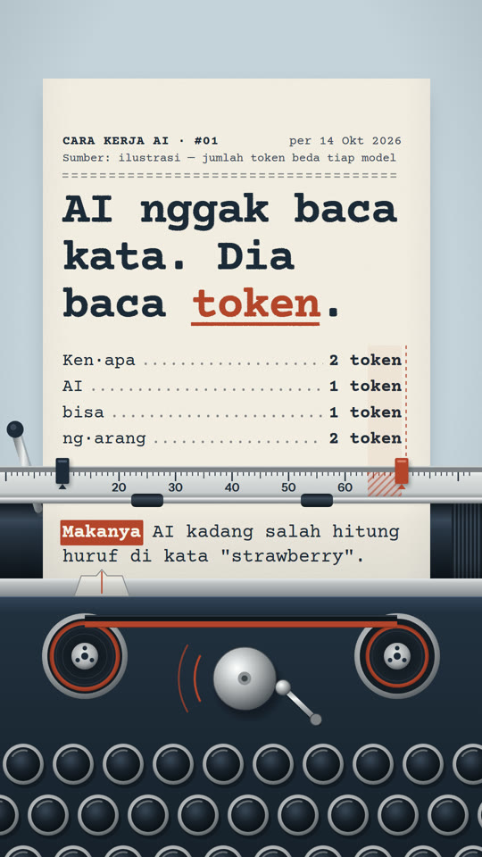 | **Margin Bell** `margin-bell` | template · New | pastel · mono · 2.5D · physical-object | how-ai-works, ai-tools | Top-down portable typewriter on a powder-blue desk: typed sheet, steel margin scale with a red right stop and bell zone, ribbon spools and a chrome bell. Metaphor: max output tokens, a hard length budget per reply. |
| 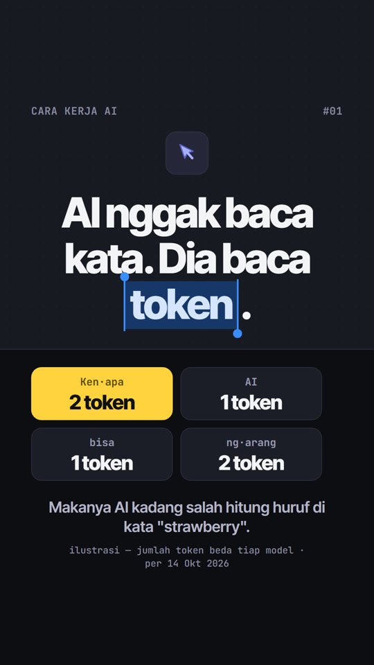 | **Marquee Select** `marquee-select` | template · Liked | dark · grotesque · 2D · app-ui | ai-tools | Dark headline panel with a design-tool selection box on the key word and stat chips. |
| 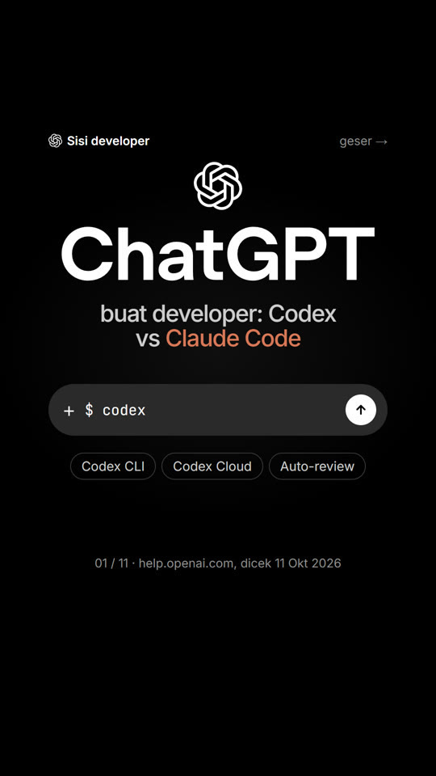 | **Midnight Chat** `midnight-chat` | reference · Liked | dark · grotesque · 2D · app-ui | ai-tools | Pure-black chat transcript where each slide is a question bubble followed by its answer. |
| 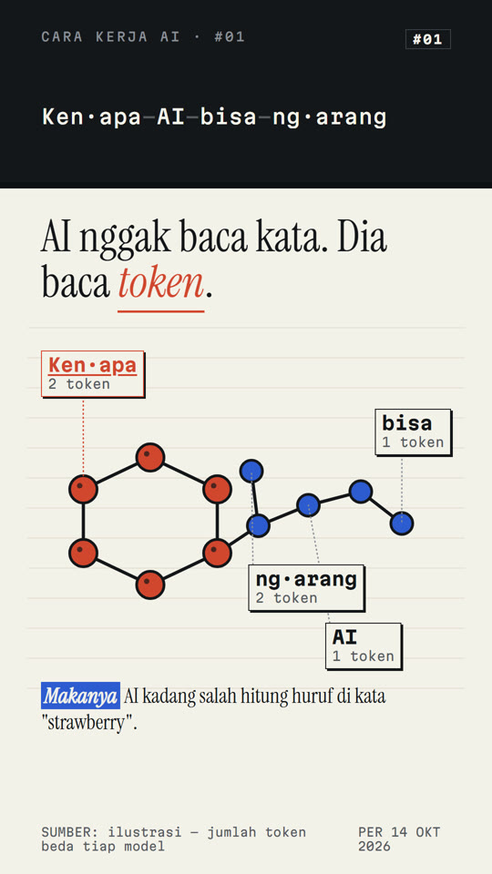 | **Molecule String** `molecule-string` | template · New | dark-to-light · mono · 2.5D · code | ai-news, how-ai-works | A chemistry bench where a SMILES label strip unrolls and folds into a ball-and-stick model. Metaphor: a molecule is one line of text, so a language model writes drug candidates with the same next-token trick. |
| 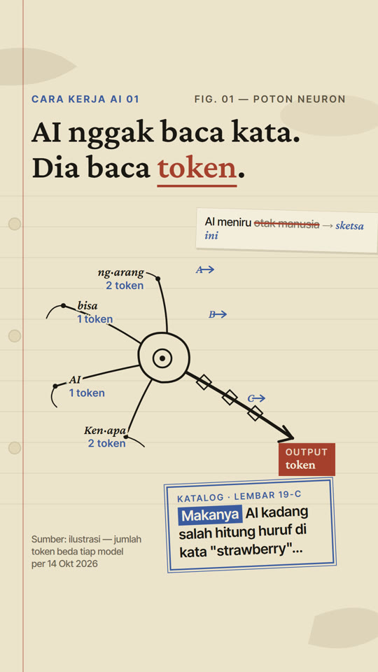 | **Neuron Ink** `neuron-ink` | template · New | pastel · serif · 2D · diagram | how-ai-works | A scientist's pen-and-ink sketch of one neuron with a blue catalogue stamp. Metaphor: where 'neural network' comes from, the artificial neuron copies only this sum-and-fire sketch. |
| 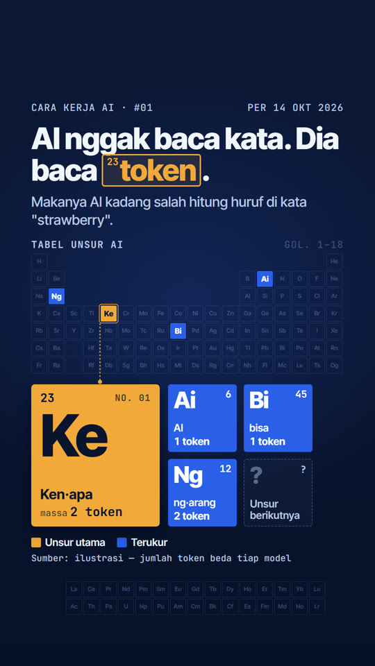 | **Periodic Elements** `periodic-elements` | template · New | dark · grotesque · 2D · data | how-ai-works, ai-news | A navy periodic table where every AI term is an element. Metaphor: build a vocabulary of AI 'elements'. |
| 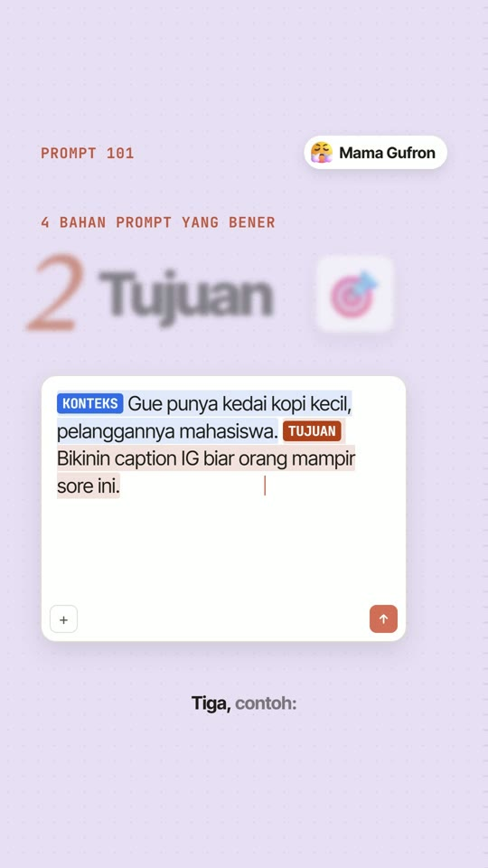 | **Prompt Classroom** `prompt-classroom` | reference · Maybe | pastel · serif · 2D · app-ui |  | A friendly prompt lesson: character chips, a chat box being filled, before/after cards. |
| 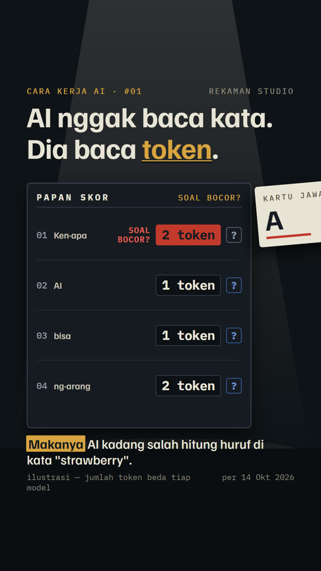 | **Quiz Podium** `quiz-podium` | template · New | dark · grotesque · 3D · physical-object | ai-news, how-ai-works | A 1950s TV quiz set with flip-board scores. Metaphor: benchmark contamination, a perfect score can be memorisation when questions and answers leaked into training data. |
| 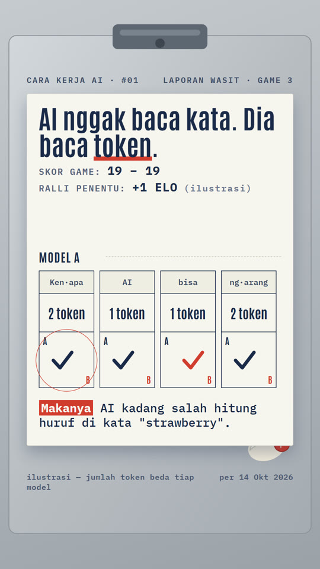 | **Rally Sheet** `rally-sheet` | template · New | light · condensed · 2.5D · code | ai-in-numbers, ai-news | A badminton umpire's score sheet on an aluminium clipboard. Metaphor: model arenas, two anonymous answers duel, people pick one, and millions of rallies build an Elo rating. |
| 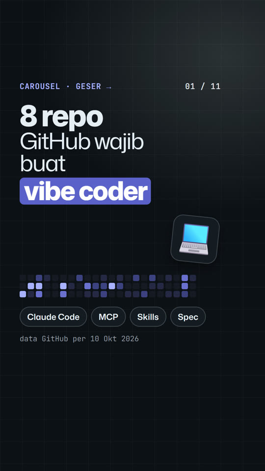 | **Repo Cards** `repo-cards` | reference · Liked | dark · grotesque · 2D · data |  | Dark GitHub-style repo cards with stars, licence and activity, ranked #1, #2, #3. |
| 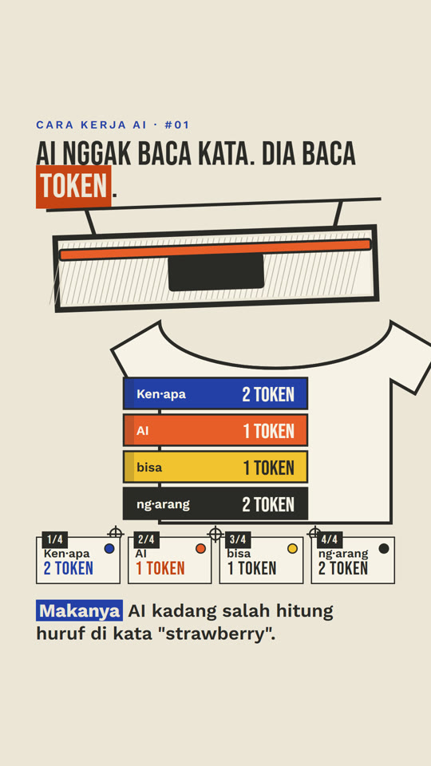 | **Sablon Pass** `sablon-pass` | template · New | full-colour · condensed · 2.5D · poster | how-ai-works | An Indonesian t-shirt screen-printing bench with hinge clamps and a squeegee. Metaphor: neural-network layers, each print pass adds one kind of feature until the full picture appears. |
| 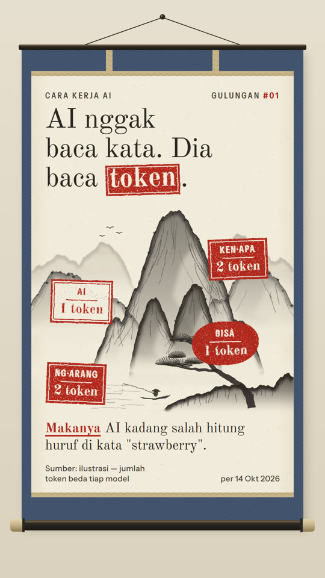 | **Seal Chop** `seal-chop` | template · New | light · serif · 2D · physical-object | ai-news, ai-tools | A hanging ink-landscape scroll whose margins fill with red collector seals, each recording who owned or changed it. Metaphor: content provenance / AI labels, the chain of stamps an image now carries. |
| 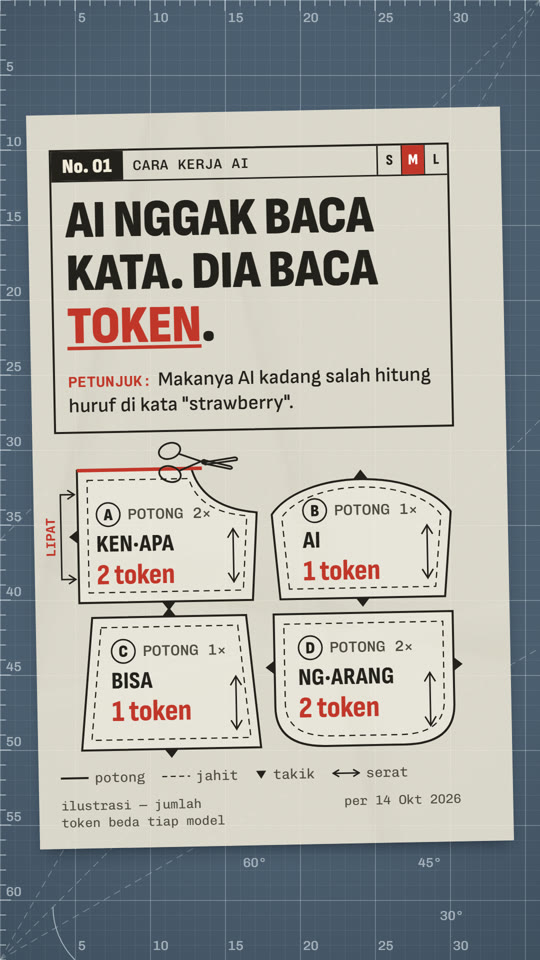 | **Sewing Pattern** `sewing-pattern` | template · New | full-colour · condensed · 2D · physical-object | how-ai-works, ai-tools | A tissue sewing pattern on a slate cutting mat. Metaphor: tokenisation = cutting a pattern into pieces. |
| 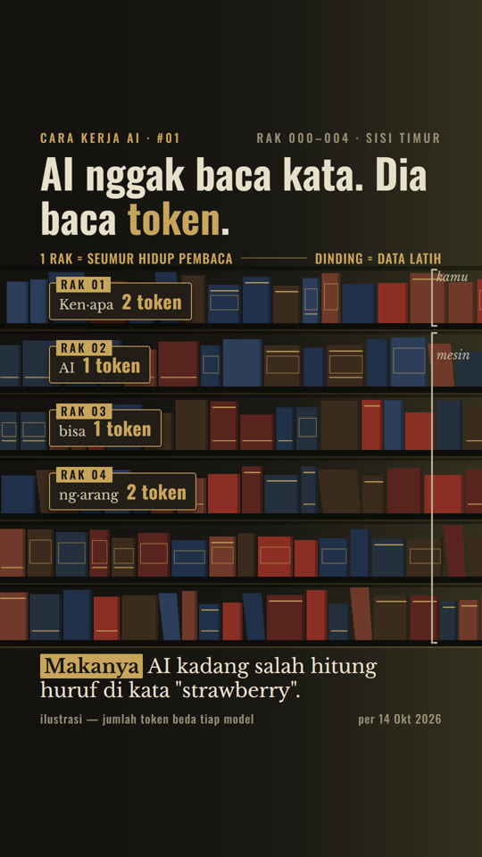 | **Spine Shelf** `spine-shelf` | template · New | dark-to-light · condensed · 3D · data | ai-in-numbers | A wall of library shelves. Metaphor: training-data scale, one shelf is a lifetime of one person's reading, the whole wall is a model's corpus. |
|  | **Spirit Level** `spirit-level` | template · New | light · grotesque · 3D · physical-object | how-ai-works, ai-news | An aluminium spirit level on a concrete wall. Metaphor: alignment, tilt one way and the model refuses everything, the other way it obeys anything; tuning re-centres the bubble. |
|  | **Split Tally** `split-tally` | template · New | pastel · serif · 3D · code | ai-news, how-ai-works | A split hazel tally stick (stock and foil) on vellum with a red wax seal. Metaphor: AI provenance and watermarks, only the matching half lines up exactly; copies and edits don't. |
|  | **Sticker Collage** `sticker-collage` | reference · Liked | pastel · grotesque · 2D · app-ui | ai-in-numbers | Pastel design board mixing a selection-boxed headline with 3D icon stickers and price cards. |
|  | **Survey Meter** `survey-meter` | template · New | full-colour · condensed · 3D · physical-object | how-ai-works, ai-in-numbers | A yellow civil-defence radiation survey meter. Metaphor: sampling, every word is a weighted dice roll, yet the needle's average stays steady. |
|  | **Tempeh Culture** `tempeh-culture` | template · New | dark · mono · 3D · abstract | how-ai-works, ai-in-numbers | Cross-sections of tempeh blocks on a dark cutting board, stamped by hour. Metaphor: training builds connections, loose beans (data) get bound by mycelium (weights) into one solid model. |
|  | **Terminal Noir** `terminal-noir` | template · Liked | dark · mono · 2D · code | ai-tools | A terminal window where each item is a line of command output. |
|  | **Topo Trail** `topo-trail` | template · New | light · condensed · 2.5D · diagram | how-ai-works | A topographic hiking map whose orange trail is a true steepest descent. Metaphor: training = walking downhill to the lowest point. |
|  | **Unpaid Clicks** `unpaid-clicks` | template · New | light · grotesque · 2.5D · app-ui | how-ai-works | A 'pilih semua kotak' image-grid verification on a phone, duotone street photos; ticked tiles flip to coral bounding boxes + label tags. Metaphor: data labelling, AI learns to see from unpaid human clicks. |
|  | **Well Plate** `well-plate` | template · New | pastel · mono · 3D · data | ai-in-numbers, how-ai-works | A 96-well microplate in 3D fed by an 8-channel pipette. Metaphor: why AI needs GPUs, a CPU fills one well per move, a GPU fills thousands of identical small sums at once. |

## Claude Fable

| Cover | Name · id | Type · rating | Look (background · type · depth · visual) | Series | Idea |
|---|---|---|---|---|---|
|  | **Architect's Model** `architect-model` | template · Liked | light · grotesque · 3D · physical-object | how-ai-works, ai-tools | A white cardboard architect's study model on a grey site board; block height = magnitude. |
|  | **Bento Box** `bento-box` | template · New | dark · grotesque · 2.5D · physical-object | ai-in-numbers, ai-news, ai-tools | A bento box as structured output / JSON: each compartment = a field. |
|  | **Card Catalog** `card-catalog` | template · New | light · mono · 3D · physical-object | how-ai-works, ai-tools | A library card catalogue as RAG/embeddings: cards stored near their neighbours. |
|  | **Chess Notation** `chess-notation` | template · New | light · serif · 2D · diagram | how-ai-works, ai-tools | Chess diagram with move notation as chain-of-thought: thinking several moves ahead. |
|  | **Chromatography Strip** `chromatography` | template · New | pastel · mono · 2.5D · physical-object | how-ai-works, ai-in-numbers | A chromatography strip separating one mixture (prompt, dataset, trend) into its components. |
|  | **Dartboard** `dartboard` | template · New | dark · condensed · 3D · physical-object | how-ai-works, ai-in-numbers | Accuracy vs precision vs hallucination: tight but off-centre = consistent but wrong. |
|  | **Data Annotation** `data-annotation` | template · Liked | light · serif · 2D · data | how-ai-works, ai-in-numbers | Data-journalism chart: one clean graphic, one point that matters, one editorial note pointing at it. |
|  | **Fingerpost** `fingerpost` | template · New | full-colour · condensed · 2.5D · physical-object | ai-in-numbers, ai-news, ai-tools | A signpost with arms pointing to options: routing a prompt to a model, tool or plan; distance = cost. |
|  | **Instrument Panel** `instrument-panel` | template · Liked | light · mono · 2.5D · physical-object | how-ai-works, ai-tools | A synth/instrument faceplate where AI parameters (temperature, top-p, context) are knobs and LCDs. |
|  | **Loom Weave** `loom-weave` | template · New | full-colour · grotesque · 2D · abstract | how-ai-works | A loom as attention: each token = a warp thread; each pass of the weft touches every thread. |
|  | **Nautical Night** `nautical-night` | template · New | dark · mono · 2D · data | how-ai-works, ai-in-numbers | A night nautical chart: soundings = how confident the model is; shallows = hallucination risk. |
|  | **Nutrition Label** `nutrition-label` | template · Maybe | full-colour · grotesque · 2D · data | ai-in-numbers, ai-news, ai-tools | A 'Nutrition Facts' label reading out what a model, prompt or feature contains. |
|  | **Piano Roll** `piano-roll` | template · New | light · mono · 2.5D · physical-object | how-ai-works | A player-piano roll: the next hole not yet visible = the next token. |
|  | **Postage Stamps** `postage-stamps` | template · New | light · serif · 2.5D · physical-object | ai-in-numbers, ai-news | A sheet of stamps: one stamp = one token with a face value; the sheet = the context window. |
|  | **Rice Parcel** `rice-parcel` | template · New | light · grotesque · 3D · physical-object | how-ai-works, ai-tools | A folded rice parcel as the context window: it only holds so much; each fold opened = one part of the context. |
|  | **Rock Strata** `rock-strata` | template · New | dark · grotesque · 2.5D · diagram | how-ai-works, ai-in-numbers | Rock layers as the stages of building a model: thick pre-training at the bottom, thin fine-tuning on top. |
|  | **Split-Flap Board** `split-flap` | template · Liked | dark · condensed · 2.5D · physical-object | ai-in-numbers, ai-news | A station split-flap departure board; news, numbers and status flip in line by line. |
|  | **Transit Map** `transit-map` | template · Liked | light · grotesque · 2D · diagram | how-ai-works | A Beck-style transit diagram: one AI concept = one line, each step = a station. |
|  | **Tree Rings** `tree-rings` | template · New | pastel · grotesque · 2D · data | how-ai-works, ai-in-numbers, ai-news | Tree rings as history: one ring per year or model release; thick = boom year, thin = AI winter. |
|  | **Weather Chart** `weather-chart` | template · New | pastel · grotesque · 2D · diagram | how-ai-works, ai-in-numbers | A synoptic weather chart: AI output is a probability forecast, not certainty. |
|  | **Woodcut Print** `woodcut` | template · New | dark · condensed · 2.5D · physical-object | ai-in-numbers, ai-news | Carved wooden type as model weights fixed in training; each print pull = one inference. |

## ChatGPT Astra

| Cover | Name · id | Type · rating | Look (background · type · depth · visual) | Series | Idea |
|---|---|---|---|---|---|
|  | **Accordion Book** `accordion-book` | concept · New | Buku lipat, tab, kertas | how-ai-works | A folding accordion book with tabs that unfold the explanation page by page. |
|  | **Baggage Belt** `baggage-belt` | concept · New | Koper, ban berjalan, pengalih | how-ai-works | A baggage conveyor with diverters routing sentence pieces to the right place. |
|  | **Letterpress Desk** `letterpress-desk` | concept · New | Meja cetak, blok huruf, kertas | how-ai-works | Metal type blocks and a press compose the text a little at a time. |
|  | **Marble Gates** `marble-gates` | concept · New | Kelereng kuningan, gerbang, rel | how-ai-works | One brass marble, many gates: the path it takes is the answer being chosen. |
|  | **Measuring Glass** `measuring-glass` | concept · New | Gelas ukur, cairan, baki | how-ai-works | Graduated glasses filled to different levels: how likely each next word is. |
|  | **Next Stitch** `next-stitch` | concept · New | Kain, benang, kapur jahit | how-ai-works | Fabric, thread and tailor's chalk: each new stitch continues the previous ones. |
|  | **Open Kitchen** `open-kitchen` | concept · New | Tutup saji, piring, tiket pesanan | how-ai-works | An open kitchen with order tickets and covered plates: the reply is cooked step by step. |
|  | **Receipt Printer** `receipt-printer` | concept · New | Printer, rol kertas, struk | how-ai-works | A receipt printer printing the answer bit by bit, like the AI building a reply. |
|  | **Ticket Raffle** `ticket-raffle` | concept · New | Kotak bening, tiket, baki | how-ai-works | A clear raffle box of tickets; one ticket is drawn to continue the sentence. |
|  | **Tile Library** `tile-library` | concept · New | Ubin keramik, baki sampel | how-ai-works | A ceramic tile sample library where each tile is a filed piece of knowledge. |
